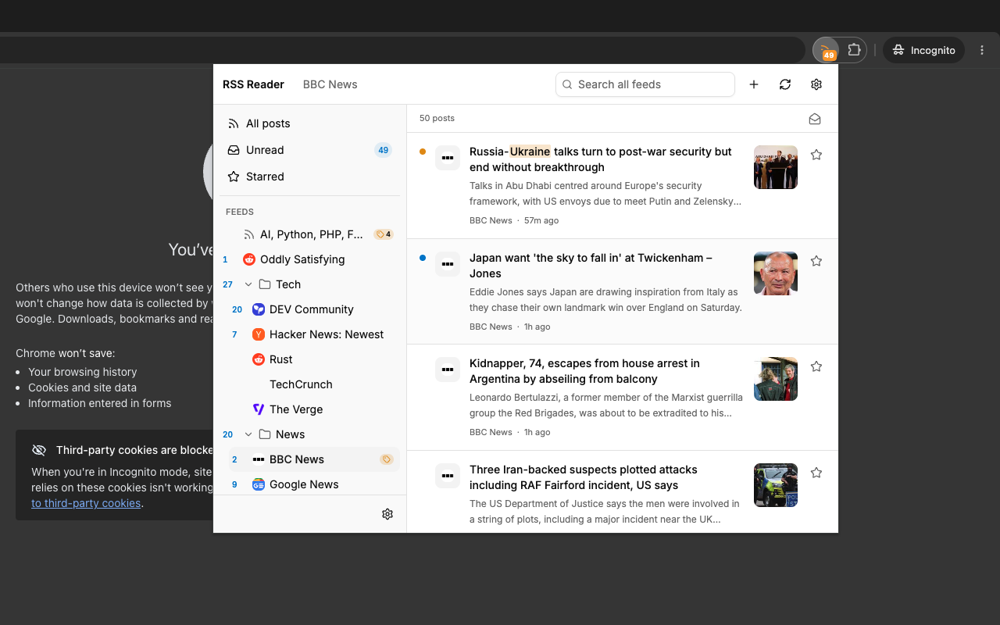

# RSS Reader

A local-first browser extension for RSS, Atom, RDF and JSON feeds. 
No account, hosted API's, analytics or remote push, everything lives inside the browser, offline.



### Technology

- **[Extension.js](https://extension.js.org/)** — Manifest V3 framework (Chrome, Firefox, Edge)
- **React + TypeScript** — popup UI and shared logic
- **[Dexie 4](https://dexie.org/) + dexie-react-hooks** — IndexedDB wrapper with live React queries
- **Tailwind + Radix UI / shadcn** — utility-first styling
- **Vitest** — unit, DB, parser, popup and E2E tests

### Settings

- **General:** theme (system/light/dark), refresh interval (30 seconds to 1 hour; 15 minutes default), retention per feed (default 200), notifications, mark read on open, start view (All/Unread/Starred), and remember app state (last view, collapsed folders and open post; on by default).
- **Feeds:** add, edit and delete feeds; see URL, folder, last fetch and last error; set per-feed watch words as tags
- **Folders:** add, rename, reorder and delete folders
- **OPML:** import a file or export subscriptions
- **Storage:** read-only store table and record counts, browser storage estimate, and Clear all data

**Note:** Clear all data removes feeds, folders, posts and settings (including the saved app state) from IndexedDB. It does not remove the last-view selection stored in `localStorage`.

### Behaviour

- First fetch imports existing entries as read; later fetches add new ones as unread.
- Each feed retains the newest 200 posts by default (configurable); aggregate views cap at 200.
- Feeds refresh on a dynamic alarm (15min default); failures back off exponentially up to 1 hour.
- Media is responsive: most images/video cap at 60vh, native controls, sandboxed iframes, no autoplay.
- Per-feed watch words are matched against post titles, excerpts and feed content with word-form and typo tolerance. Matching feeds show an amber tag in the sidebar, matching posts show a yellow dot beside the unread dot, and matching text is highlighted in the post list and reader. The yellow dot stays after the post is read.
- Reddit posts load their comments below the media card. Nested replies fold with `[+]` / `[-]`; **Load more** fetches up to 500 comments, then becomes **Refresh**. If Reddit blocks the comment request, the card's **View on Reddit** link remains available.
- Pin a post (pin icon before the star) to open it in a separate resizable window that stays open. It opens as a normal 600×700 window near the popup, keeps only the article, and has a slim header with an X to close it. One window per post; pinning the same post again focuses its existing window.
- With **Remember app state** enabled, the popup reopens on the last view, with collapsed folders and the open post restored.
- The **Starred** smart view shows its own count badge. It counts retained starred posts and does not affect the toolbar unread badge.

## Development

```bash
npm install
npm run dev          # Extension.js dev browser
npm start            # Extension.js start
npm run build:chrome # production build in dist/chrome
npm run build:firefox
npm run build:edge
npm run preview      # preview the production build
npm test             # Vitest unit, DB, parser, popup and local-fixture tests
npm run test:watch   # Vitest watch mode
npm run test:e2e     # Chrome for Testing smoke test with local fixtures
npm run typecheck    # tsc --noEmit
```

`npm run test:e2e` discovers Playwright’s Chrome for Testing cache on macOS and checks common Chrome/Chromium locations. Set `CHROME_BIN` to a Chrome for Testing or Chromium binary if it is installed elsewhere. Current branded Chrome builds ignore `--load-extension`.

Run `npm run build:chrome` before `npm run test:e2e`; the E2E test uses the built extension in `dist/chrome`, not the source tree.

## Loading the extension

Requires Chrome 110 or newer.

1. `npm run build:chrome`
2. Open `chrome://extensions`.
3. Enable Developer mode.
4. **Load unpacked** → `dist/chrome`.

Use a fresh extension profile: this is a new extension identity with a fresh `rss-reader` database and no migration from older products.

### Privacy

No account, analytics, or tracking. See [PRIVACY.md](PRIVACY.md) for what is stored locally and which sites the extension contacts.

## License

MIT
